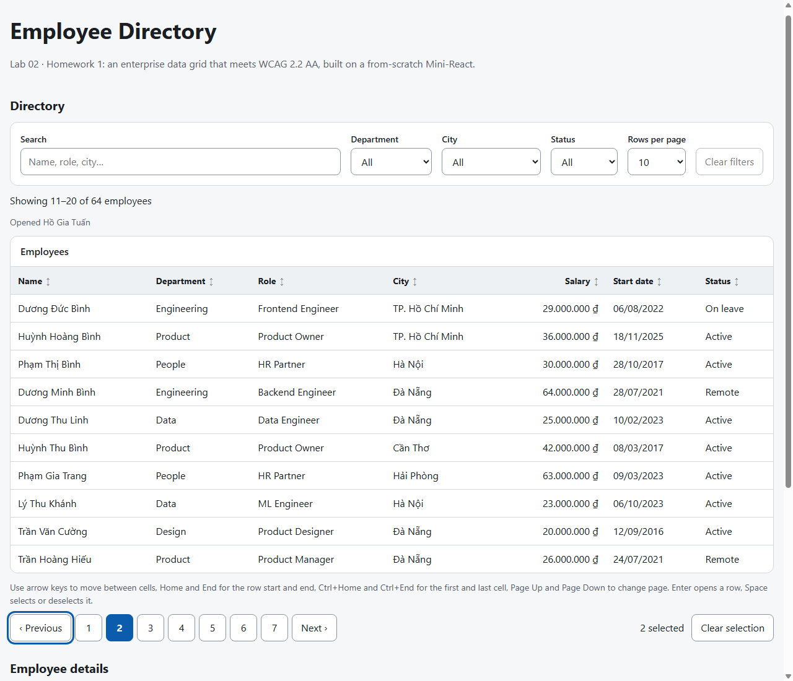
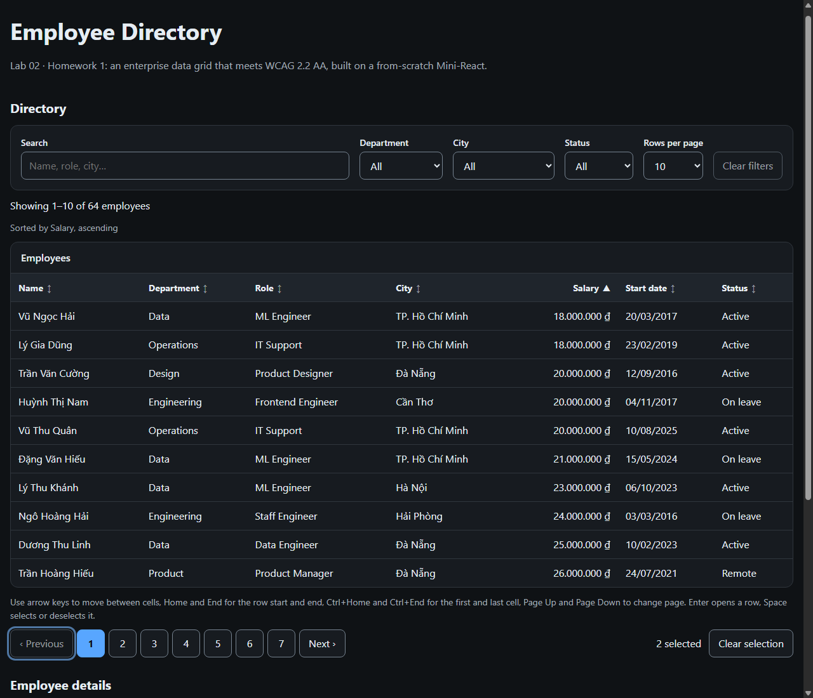

# Lab 02 · Homework 1: Production Enterprise Data-Grid (WCAG 2.2 AA)

An accessible employee directory: a data grid with **sorting, filtering and pagination**, full
**keyboard navigation** (Arrows move, **Enter selects**, **Space toggles**) and native table semantics.
Built from scratch on the Lab 02 Mini-React engine, which this homework upgrades with **keyed O(n)
reconciliation** and **`useEffect`**.

| Gate | Result |
|------|--------|
| Lighthouse 13.6.0 Accessibility, production build | **100 / 100** ([report](docs/lighthouse/report.html)) |
| Lighthouse 13.6.0 Best Practices | **100 / 100** |
| axe-core 4.14 (WCAG 2.0/2.1/2.2 A+AA + best practices), 5 grid states | **0 violations** |
| axe `color-contrast` in real Chrome, light + dark, 3 states each | **0 violations** (105–123 nodes checked per run) |
| Unit / component / checkpoint tests | **228 passing** |



- Rules: [project-rules.md](project-rules.md)
- Work breakdown: [TASK_DECOMPOSITION.md](TASK_DECOMPOSITION.md)

## Run

```bash
npm install
npm run dev        # http://localhost:5173
npm test           # 228 tests, including axe-core audits (Vitest + jsdom)
npm run typecheck  # tsc --noEmit (strict)
npm run build && npm run preview   # production build, which Lighthouse was run against
```

## Contract

The grid implements the slide contract, extended with a stable row identity:

```ts
interface ColumnDef<T> { header: string; accessorKey: keyof T; sortable?: boolean; filterable?: boolean; align?: 'start' | 'end'; format?: (value, row) => string }
interface DataGridProps<T> { data: T[]; columns: ColumnDef<T>[]; onRowSelect?: (item: T) => void; ariaLabel: string; getRowId: (item: T) => string }
```

## Keyboard

| Key | Action |
|-----|--------|
| <kbd>Tab</kbd> | The grid is **one** Tab stop (roving `tabindex`); Tab leaves to the pagination |
| <kbd>←</kbd> <kbd>→</kbd> <kbd>↑</kbd> <kbd>↓</kbd> | Move one cell; ↑ from the first row enters the header |
| <kbd>Home</kbd> / <kbd>End</kbd> | First / last cell of the row |
| <kbd>Ctrl</kbd>+<kbd>Home</kbd> / <kbd>Ctrl</kbd>+<kbd>End</kbd> | First cell of the grid / last cell of the page |
| <kbd>Page Up</kbd> / <kbd>Page Down</kbd> | Previous / next page, focus stays in the same cell position |
| <kbd>Enter</kbd> | **Selects** (opens) the row: `onRowSelect`, details panel, `aria-current` |
| <kbd>Space</kbd> | **Toggles** the row in the multi-selection (`aria-selected`) |
| <kbd>Enter</kbd> / <kbd>Space</kbd> on a header | Sort: none → ascending → descending → none (`aria-sort`) |

Mouse: click = Enter, Ctrl/⌘+click = Space. The key model is a pure reducer (`src/grid/navigation.ts`).
The position is read from the focused cell's `data-row`/`data-col`, so keys act on the right cell even when
focus arrived without the grid knowing (screen-reader cursor, programmatic focus).

## WCAG 2.2 AA checklist

| Criterion | How it is met |
|-----------|---------------|
| 1.3.1 Info & Relationships | Native `<table>`, `<caption>`, `<thead>`, `<tbody>`, `<th scope="col">`; labelled controls; `<dl>` details |
| 1.3.2 Meaningful Sequence | DOM order = visual order (toolbar → status → grid → pagination → details) |
| 1.4.1 Use of Color | Selected rows also get an inset bar; sort state has ▲/▼ glyphs; current page is bold |
| 1.4.3 Contrast (Minimum) | Text ≥ 4.5:1 in light **and** dark themes, checked by axe in Chrome |
| 1.4.10 Reflow | No page-level horizontal scroll at 320 px; only the data table scrolls (allowed for 2-D tables) |
| 1.4.11 Non-text Contrast | Focus rings, borders and the selection bar ≥ 3:1 |
| 1.4.12 Text Spacing | No fixed heights on text containers |
| 1.4.13 Content on Hover | No hover-only content |
| 2.1.1 Keyboard / 2.1.2 No Trap | Everything works from the keyboard; Tab always leaves the grid |
| 2.4.3 Focus Order | Roving tabindex; focus is restored after paging and never dropped (`aria-disabled` instead of `disabled`) |
| 2.4.6 Headings & Labels | `h1` → `h2` sections; every input/select has a visible `<label>` |
| 2.4.7 Focus Visible | 3 px focus ring on every control and cell (drawn inside cells so the scroll box can't clip it) |
| 2.4.11 Focus Not Obscured (Min) | No sticky overlays; `scroll-padding` keeps focused items clear of the edges |
| 2.5.8 Target Size (Minimum) | Buttons, selects and header buttons ≥ 44 px (requirement: 24 px) |
| 3.2.1 / 3.2.2 On Focus / On Input | Focus never triggers navigation; filters only change the result set |
| 3.3.2 Labels or Instructions | Visible keyboard help text referenced by `aria-describedby` |
| 4.1.2 Name, Role, Value | ARIA grid roles, `aria-sort`, `aria-selected`, `aria-multiselectable`, `aria-rowcount`, `aria-rowindex`, `aria-current` |
| 4.1.3 Status Messages | Result counts and actions (sort, select, open, clear) are announced via two `role="status"` regions |

## Engine upgrades (this homework)

**Keyed reconciliation** (`src/reconcile.ts`). Exercises 1–3 re-mounted the whole tree on every state
change, which destroyed focus and DOM state. `renderApp` now:

1. resolves components (all hooks run first), then
2. `patch`es the live DOM against the previous tree. A type change replaces the subtree (heuristic 1);
   children are matched by `key` (index fallback) in one O(n) pass (heuristic 2); identical subtrees are skipped.
3. syncs live `value` / `checked` / `selected` properties after children exist, so inputs stay controlled.

Duplicate keys and a DOM changed behind the engine throw. A 200-step randomized test checks that patching
always produces the same HTML as a fresh render.

**`useEffect`** (`src/use-effect.ts`). Effects run after the commit, with `Object.is` dependency comparison,
cleanup before re-runs and on unmount. The grid uses one effect to move focus after keyboard navigation.

## Structure

| Path | Responsibility |
|------|----------------|
| `src/grid/types.ts` | Grid contracts |
| `src/grid/pipeline.ts` | Pure filter (diacritic-insensitive) → stable sort (Vietnamese collation) → paginate |
| `src/grid/navigation.ts` | Pure keyboard reducer (APG data-grid model) |
| `src/grid/data-grid.ts` | `DataGrid` view: toolbar, live status, ARIA grid, selection, pagination |
| `src/employees.ts`, `src/app.ts` | Deterministic dataset, columns, directory + details panel |
| `src/reconcile.ts`, `src/use-effect.ts` | Engine upgrades |
| `tests/a11y.test.ts` | axe-core audits per grid state, plus a control test proving violations are caught |

## How it was verified

1. `npm test`: pipeline, navigation reducer, component behaviour, engine, axe-core.
2. Real Chrome via the DevTools Protocol with **real key presses** (`Input.dispatchKeyEvent`). The Tab order runs
   search → 3 facets → page size → Clear filters → **grid (one stop)** → pagination. Arrows, Space, Enter, Ctrl+End
   and PageDown behave as specified. No listeners sit on child elements (`getEventListeners`), and every commit
   logs `audit PASS`.
3. `npx lighthouse http://localhost:4173 --only-categories=accessibility,best-practices` on `npm run preview`
   gives 100 / 100 ([HTML report](docs/lighthouse/report.html), [JSON](docs/lighthouse/report.json)).
4. axe `color-contrast` injected into Chrome with `prefers-color-scheme` emulated as light and dark: 0 violations.


